# Active Directory Homelab

I built an Active Directory domain on VMware to practice everyday IT administration and later use it as an attack surface to practice Active Directory attacks and how to defend against them. 

## Lab setup
- DC01: Windows Server 2022, 4 GB RAM, 2 CPU, VMware NAT
- Domain: lab.local (NetBIOS: LAB), DC01 at 172.16.106.10

## Progress
- [x] Phase 1: Domain controller and DNS
- [x] Phase 2: OUs, users and groups (Spider-Man themed)
- [x] Phase 3: PowerShell user lifecycle automation (joiner done; mover and leaver next)
- [ ] Phase 4: Join a Windows 11 client
- [ ] Phase 5: Group Policy
- [ ] Phase 6: Attack practice for PNPT


## Phase 1: Domain controller and DNS

I installed Windows Server 2022 in VMware Workstation (4 GB RAM, 2 CPUs, 60 GB disk, NAT network) and promoted it to the first domain controller of a new forest, `lab.local`.

DC01 has a static IP (172.16.106.10) because clients need a fixed address to find the domain controller. Its DNS server is set to 127.0.0.1, so the DC answers its own DNS queries. Active Directory depends on DNS: computers find the domain controller through DNS records, so if DNS is wrong, logons and domain joins fail.

To check it worked, I logged in as `LAB\Administrator`, ran `Get-ADDomain`, and tested name resolution. `lab.local` resolves to the DC, and internet names like `google.com` still resolve.

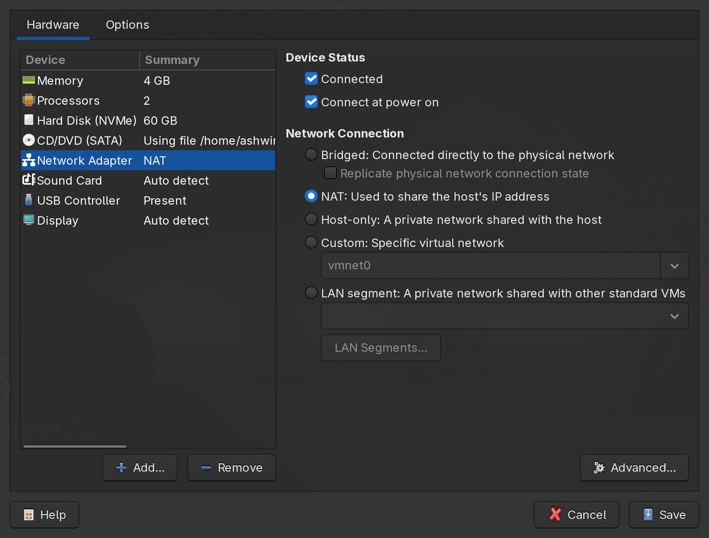
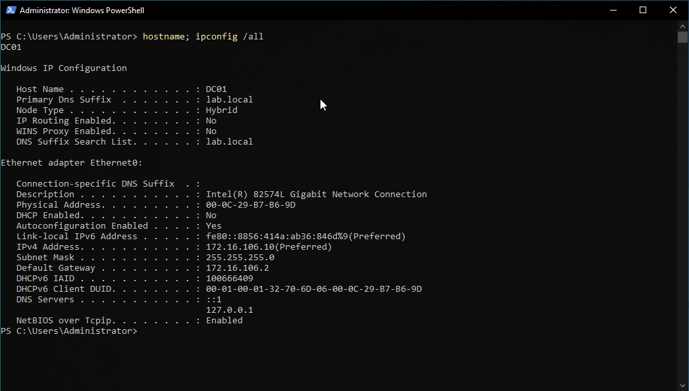
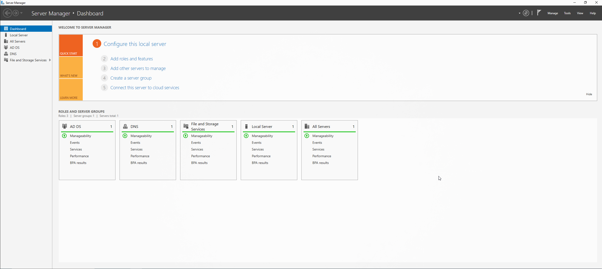
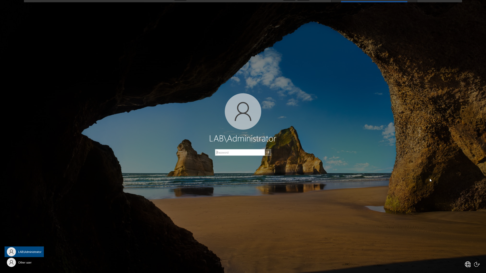
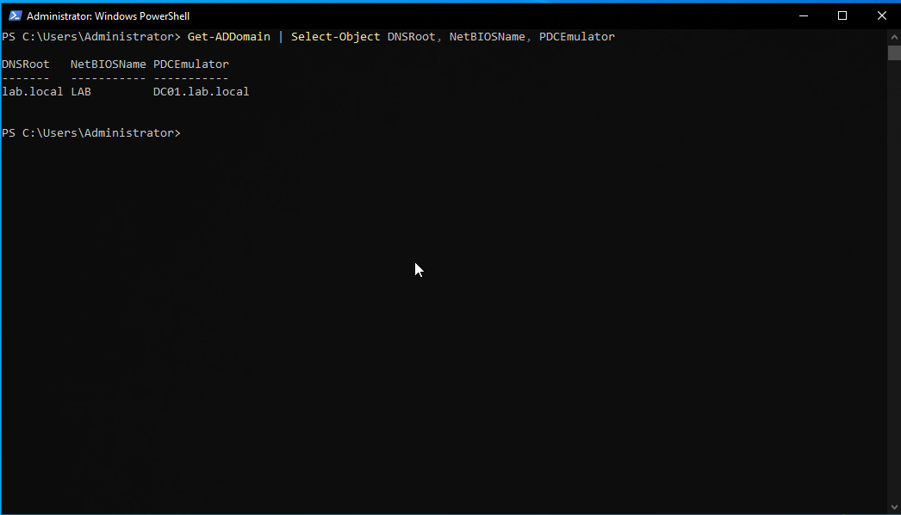
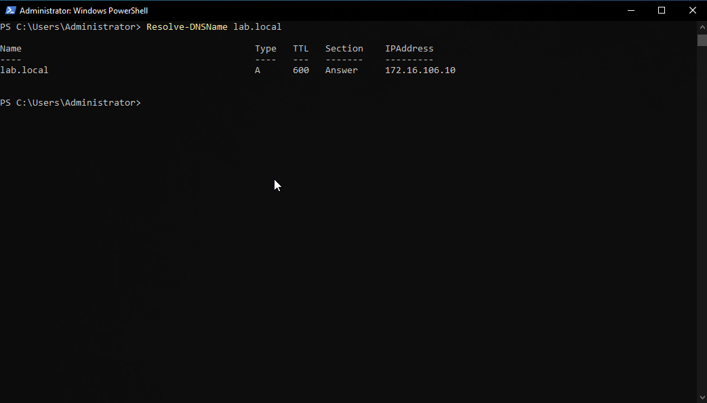
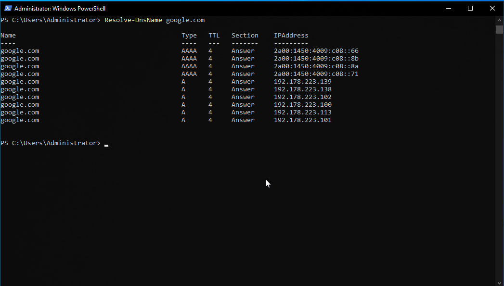

## Phase 2: OUs, users and groups

I created three OUs (LAB-Users, LAB-Computers and LAB-Groups) instead of using the default Users and Computers containers. Default containers can't have Group Policy linked to them, so keeping objects in OUs makes later phases possible.

I added five users (Peter Parker, Miles Morales, Mary Jane Watson, J. Jonah Jameson and Ned Leeds) and a security group, IT-Support, with Ned as a member. Permissions are given to groups, not to individual people.

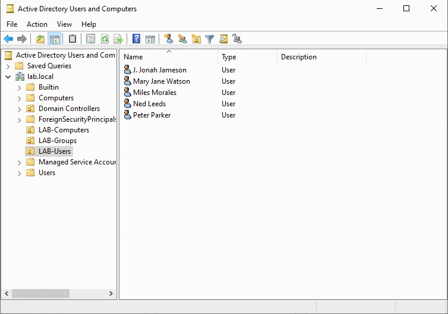
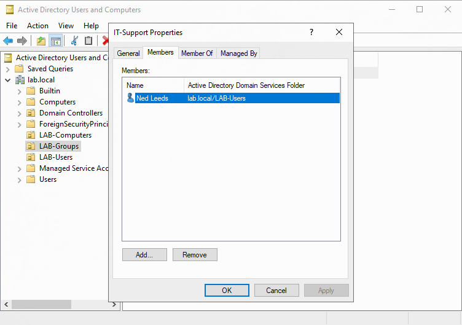

## Phase 3: PowerShell user lifecycle (joiner, mover, leaver)

On a service desk, the most common identity tickets are new starters, people changing roles, and leavers. In this phase I'm doing all three with PowerShell instead of clicking through the GUI.

### Joiner

HR sends a CSV of new starters ([new-starters.csv](scripts/new-starters.csv)). Before writing any script, I created the Sales and Finance groups and made one user, Gwen Stacy, by hand to learn each command.

That first attempt went wrong. I pressed Enter halfway through `New-ADUser`, so Gwen was created in the default Users container, with no department and no password, which means AD left her disabled. I fixed her the way a helpdesk would: `Set-ADUser` for department and title, `Move-ADObject` into LAB-Users, `Set-ADAccountPassword -Reset` with a change at next logon, and `Enable-ADAccount`.

Then I wrote [joiner.ps1](scripts/joiner.ps1). For each row in the CSV it:
- skips the user if the account already exists, so the script is safe to run again
- creates the account in LAB-Users with the department and title from the CSV
- sets a temporary password that is typed in when the script runs (never stored in the script) and must be changed at first logon
- adds the user to their department group

The first run had a bug: a broken line continuation (backtick) on `-Path` split the command in two. The users were created without passwords, but the script still printed "Created" for each one. I reverted DC01 to the snapshot I took before running it, fixed the line, and ran it again cleanly. After that I checked the users and group memberships in AD instead of trusting the script's own output.

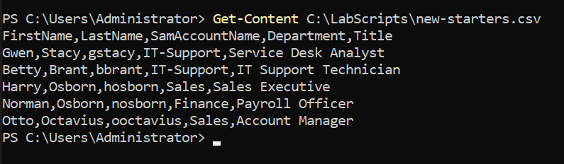
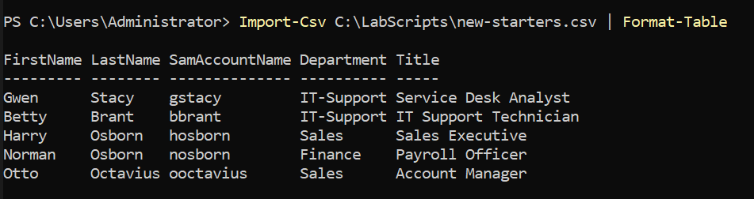
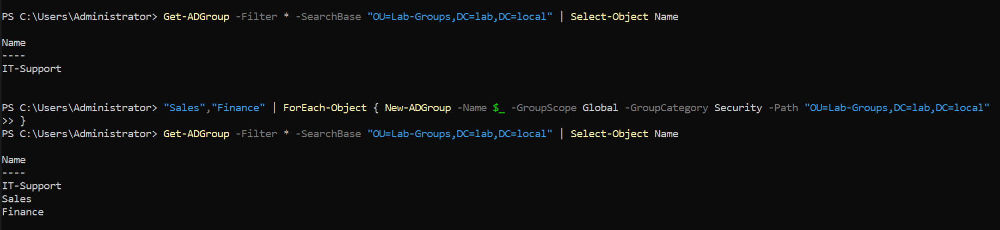
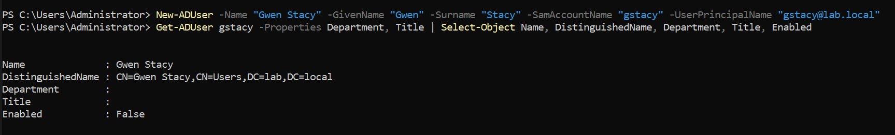
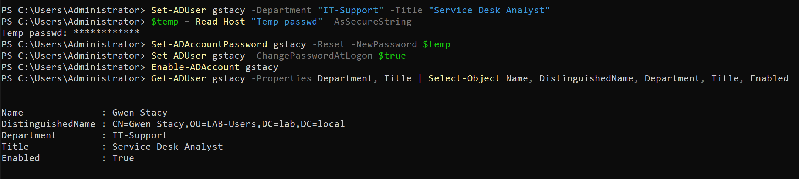
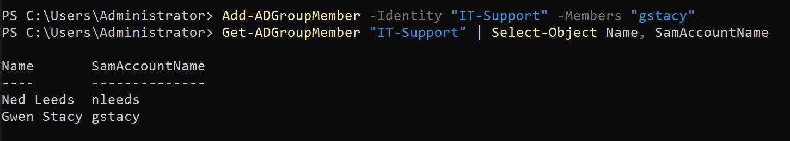
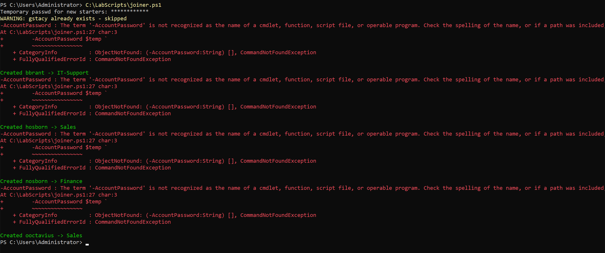
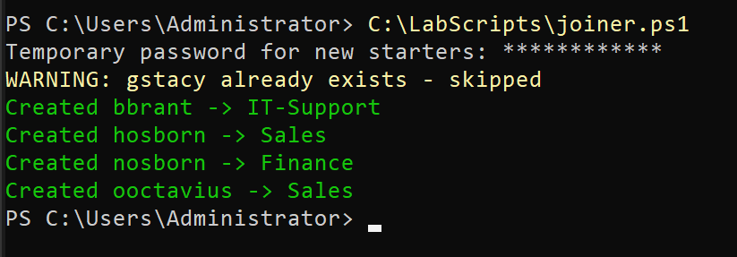
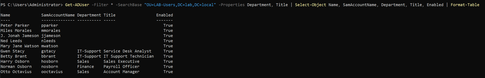
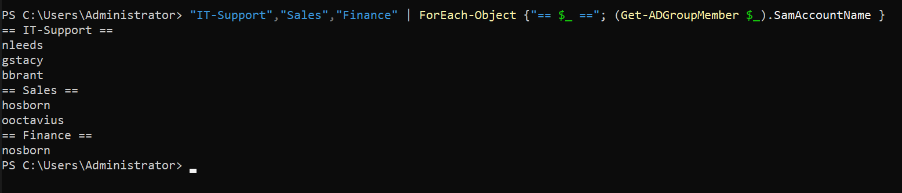


### Mover

Ticket: Harry Osborn moves from Sales to Finance. I did it by hand first: change his department and title, remove him from the Sales group and add him to Finance. Changing only the department would leave him with Sales access, which is privilege creep.

Then I wrote [mover.ps1](scripts/mover.ps1). It takes the user, new department and new title as parameters, looks up the user's current department in AD (so the old group can't be forgotten or mistyped), and stops before changing anything if the new department has no group. I tested it by moving Otto Octavius from Sales to IT-Support, and by passing a misspelled department ("IT Support") to check that it refuses and leaves the user untouched.

```powershell
.\mover.ps1 -User ooctavius -NewDepartment "IT-Support" -NewTitle "Junior Systems Administrator"
```

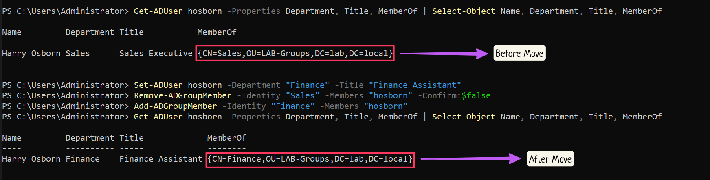
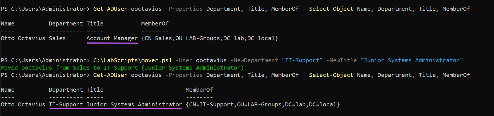
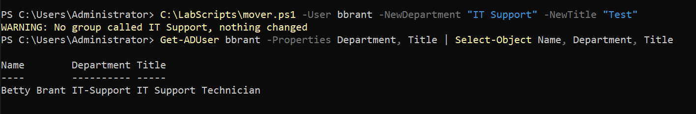

### Leaver

Ticket: Norman Osborn has left. By hand, I disabled the account first (that cuts access straight away), removed all his groups, wrote the date and reason in his description, and moved him to a new LAB-Disabled OU. I disable leavers instead of deleting them: deleting removes the account's SID, so file ownership, mailbox access and audit history would no longer link to the person.

[leaver.ps1](scripts/leaver.ps1) does the same steps. It reads the user's groups from AD rather than relying on someone typing them, so a user who built up many groups over the years is cleaned up just as fully. I tested it on Betty Brant.

```powershell
.\leaver.ps1 -User bbrant -Reason "resigned"
```

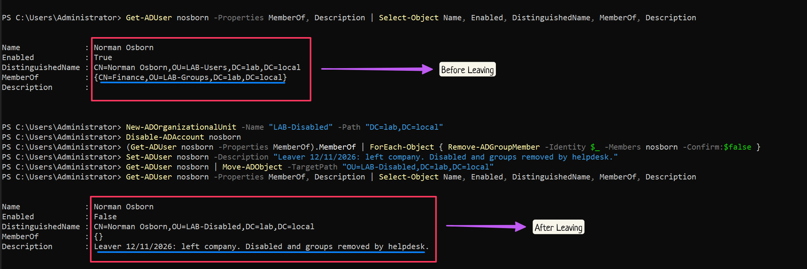
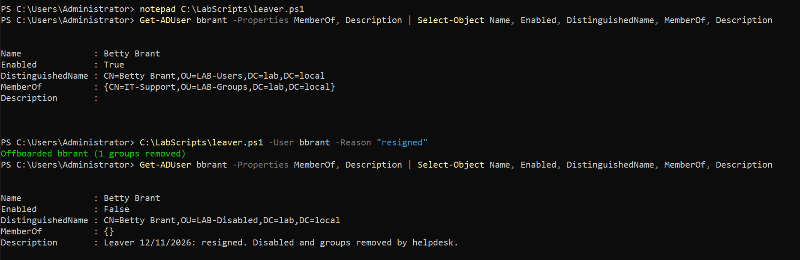

### Rehire

Ticket: Betty is coming back. Because her account was disabled and not deleted, I reused it instead of creating a new one: moved it back to LAB-Users, set a temporary password with a change at next logon, enabled it and added her back to IT-Support. Creating a second account for the same person would leave two identities for one human, which is an audit and security problem.

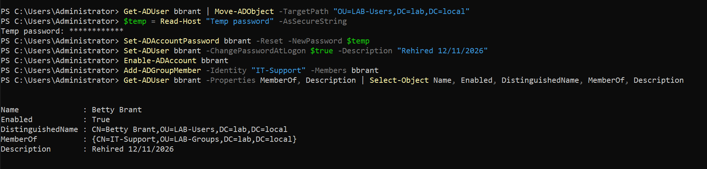

### What I'd improve next

- Stop on the first error (`$ErrorActionPreference = 'Stop'` with try/catch), so a failed step can't leave a half-built account while the script still reports success
- Make the joiner's CSV path a parameter
- Log every change to a file as well as the screen
